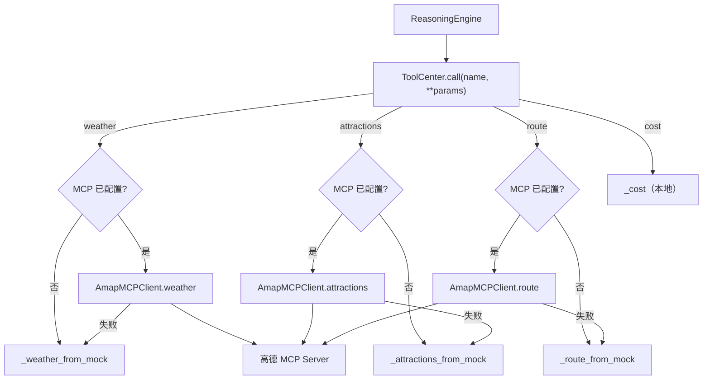

# 高德 MCP SDD

> 文件：`src/mcp_client.py`（客户端）、`src/tools.py`（接入与降级）
> 版本：v1.0 / 2026-10-21
> 上游规格：[tools.md](./tools.md)（ToolCenter）、[config.md](./config.md)（环境变量）
> 项目：travel-agent2

## 0. 实现状态说明

### v1.0 变更（2026-10-21）：接入高德地图 MCP

此前 `weather` 只有一个自定义 REST 天气源（`MCP_WEATHER_URL`），`attractions` /
`route` 均为本地 Mock。本节起改为：

| 工具 | v1.0 起的数据源 | 未配置 / 失败时 |
| --- | --- | --- |
| `weather` | **高德 MCP `maps_weather`** | 回落 `WEATHER_PATTERN` / `DEFAULT_WEATHER_PATTERN` |
| `attractions` | **高德 MCP `maps_text_search`** | 回落 `ATTRACTIONS` / `DEFAULT_ATTRACTIONS` |
| `route` | **高德 MCP `maps_geo` + `maps_direction_driving`** | 回落本地跳数估算 |
| `cost` | 本地估算（**不接 MCP**） | — |
| 目的地校验 | **高德 MCP `maps_geo`** → Mock 城市白名单 | 未命中判无效 |

旧的 `MCP_WEATHER_URL` 自定义 REST 契约由本 SDD 取代，代码不再读取该变量。

约束：

1. **MCP 是增强项，不是硬依赖**。未配置 `AMAP_MCP_URL` 时整个应用退化为纯 Mock，
   不发起任何网络请求，本地开发、单测、AC-5 降级路径均不受影响。
2. **MCP 优先、失败即降级**。单个工具的网络错误、超时、非 2xx、JSON-RPC error、
   响应结构不符契约，一律由该工具回落到同语义的 Mock 实现，**不中断行程生成**。
3. **所有 MCP 响应先解析为 Pydantic 模型**再离开客户端；`ToolCenter` 与
   `ReasoningEngine` 只看到 `WeatherInfo` / `Attraction` / `RouteResult`。

## 1. 功能描述

封装高德地图 MCP Server 的 **JSON-RPC 2.0 over Streamable HTTP** 协议，提供
天气、景点、路线、地理编码四类数据能力，并由 ToolCenter 完成「MCP 优先 + Mock
降级」的编排。

客户端职责：

- 懒加载 `httpx.AsyncClient`，首次调用时才建立连接；
- 完成 MCP 握手：`initialize` → 记录 `Mcp-Session-Id` → `notifications/initialized`；
- 以 `tools/call` 调用高德工具，解析 `content[].text` 中的 JSON（兼容 SSE 响应）；
- 提供 `close()` 释放连接与 MCP 会话；
- 把协议层异常统一收敛为 `ToolCallError`（2002）。

## 2. 接口签名

### 2.1 `AmapMCPClient`

```python
class AmapMCPClient:
    def __init__(
        self,
        url: str,
        api_key: str | None = None,
        *,
        timeout: float = MCP_TIMEOUT,
        transport: httpx.AsyncBaseTransport | None = None,
    ) -> None: ...

    async def weather(self, city: str, days: int) -> list[WeatherInfo]: ...
    async def attractions(self, city: str, limit: int = 10) -> list[Attraction]: ...
    async def route(self, city: str, spots: list[str]) -> RouteResult: ...
    async def city_exists(self, city: str) -> bool: ...
    async def close(self) -> None: ...
```

| 方法 | 含义 | 失败时 |
| --- | --- | --- |
| `weather` | 调 `maps_weather`，映射为长度 `days` 的逐日天气 | 抛 `ToolCallError` |
| `attractions` | 调 `maps_text_search`，映射为按热度排序的景点 | 抛 `ToolCallError` |
| `route` | 逐点 `maps_geo` 取坐标，再逐段 `maps_direction_driving` | 抛 `ToolCallError` |
| `city_exists` | 调 `maps_geo` 判断城市是否存在 | **不抛异常**，返回 `False` |
| `close` | 结束 MCP 会话并关闭 HTTP 连接 | 内部吞掉关闭异常 |

`transport` 仅供测试注入 `httpx.MockTransport`，生产代码不传。

### 2.2 `ToolCenter` 变更

```python
class ToolCenter:
    def __init__(self, mcp_client: AmapMCPClient | None = None) -> None: ...
    async def validate_destination(self, city: str) -> bool: ...
    async def close(self) -> None: ...

MOCK_CITY_WHITELIST: frozenset[str]  # ATTRACTIONS 的键集合
```

| 方法 | 含义 |
| --- | --- |
| `__init__(mcp_client=None)` | `None` 时按环境变量构建客户端；显式传入时作为测试注入点 |
| `validate_destination(city)` | 先查 MCP 地理编码 → 再查 Mock 白名单 → 都未命中返回 `False` |
| `close()` | 关闭内部 MCP 客户端；未配置时为空操作 |

四个内置工具的**对外签名不变**，仅数据来源与失败行为变化：

| 工具名 | 签名 | v1.0 数据来源 |
| --- | --- | --- |
| `weather` | `async (city: str, days: int) -> list[WeatherInfo]` | MCP `maps_weather` → Mock |
| `attractions` | `async (city: str, limit: int = 10) -> list[Attraction]` | MCP `maps_text_search` → Mock |
| `route` | `async (city: str, spots: list[str]) -> RouteResult` | MCP `maps_geo` + 驾车路线 → Mock |
| `cost` | `(days: int, spots: list[str], budget: float | None = None) -> CostResult` | 本地估算 |

### 2.3 工具映射表

| ToolCenter 工具 | 高德 MCP 工具 | 请求参数 | 响应映射 |
| --- | --- | --- | --- |
| `weather` | `maps_weather` | `{ "city": city }` | `forecasts` / `casts` → `WeatherInfo(date, condition, temp_high, temp_low)` |
| `attractions` | `maps_text_search` | `{ "keywords": "景点", "city": city, "citylimit": true }` | `pois[]` → `Attraction(name, city, ticket_price, rating, suggested_duration_min)` |
| `route`（取坐标） | `maps_geo` | `{ "address": spot, "city": city }` | `geocodes[0].location` → `"lng,lat"` |
| `route`（逐段） | `maps_direction_driving` | `{ "origin": "lng,lat", "destination": "lng,lat" }` | `route.paths[0].distance`（米）/ `duration`（秒）逐段累加 |
| 目的地校验 | `maps_geo` | `{ "address": city }` | `geocodes` 非空即存在 |

**景点字段兜底**（高德 POI 通常不含门票与评分）：

- 门票：优先读 `biz_ext.cost`；缺失时按名称确定性派生
  `20 + (sha256(name)[:4] % 15) × 10` 元（20–160 元，同一景点恒定）；
- 评分：优先读 `biz_ext.rating`；缺失时按名称确定性派生
  `3.5 + (sha256(name)[:4] % 16) / 10`（3.5–5.0，同一景点恒定）；
- 建议游玩时长：POI 无该字段，统一取 `DEFAULT_SPOT_DURATION_MIN = 120` 分钟。

「确定性」指只依赖名称字符串，不使用 `random` / `hash()`（后者受进程哈希种子
影响），保证同一景点在任意进程、任意时间得到相同值。

### 2.4 同步 → 异步改造

v3.0 起 `ToolCenter.call()` 已是 `async`，本次不改变调用形态：

- `AmapMCPClient` 的全部公开方法为 `async`，内部使用 `httpx.AsyncClient`；
- 握手用 `asyncio.Lock` 串行化，避免并发首调重复 `initialize`；
- Mock 实现保持同步函数，由 `ToolCenter.call()` 的 `inspect.isawaitable` 分支适配；
- `ToolCenter` 新增的 `validate_destination()` / `close()` 均为 `async`。

## 3. 外部依赖

| 依赖 | 用途 | 说明 |
| --- | --- | --- |
| 高德地图 MCP Server | 天气 / POI / 地理编码 / 驾车路线 | 默认端点 `https://mcp.amap.com/mcp`，需 API Key |
| `AMAP_MCP_URL` | MCP 端点；**配置后才启用 MCP** | 未配置 = 纯 Mock，不出网 |
| `AMAP_MCP_KEY` | 高德 API Key；若 URL 已含 `key` 参数则可留空 | 客户端会把它追加为 `?key=` |
| `httpx` | 异步 HTTP 客户端 | 已在依赖中；支持 `MockTransport` 测试注入 |
| `Mcp-Session-Id` | MCP Streamable HTTP 会话标识 | 握手响应头返回，后续请求回传 |

### 3.1 JSON-RPC 握手

```text
POST {AMAP_MCP_URL}?key=...
Content-Type: application/json
Accept: application/json, text/event-stream

{"jsonrpc":"2.0","id":1,"method":"initialize","params":{
  "protocolVersion":"2024-11-05",
  "capabilities":{},
  "clientInfo":{"name":"travel-agent2","version":"0.1.0"}}}

← 200 / Mcp-Session-Id: <sid>
{"jsonrpc":"2.0","id":1,"result":{"protocolVersion":"2024-11-05",...}}

POST {AMAP_MCP_URL}?key=...        # 通知，无 id、无响应体
{"jsonrpc":"2.0","method":"notifications/initialized"}
```

工具调用：

```text
POST {AMAP_MCP_URL}?key=...
Mcp-Session-Id: <sid>

{"jsonrpc":"2.0","id":2,"method":"tools/call","params":{
  "name":"maps_weather","arguments":{"city":"北京"}}}

← {"jsonrpc":"2.0","id":2,"result":{
     "content":[{"type":"text","text":"{...高德 JSON...}"}],
     "isError":false}}
```

兼容性：

- 响应既可能是 `application/json`，也可能是 `text/event-stream`；后者取 `data:`
  行中 `id` 与请求匹配的最后一条 JSON-RPC 消息；
- 工具结果优先取 `structuredContent`，否则拼接 `content[].text` 后解析 JSON；
- `result.isError == true` 或 JSON-RPC `error` 字段存在时抛 `ToolCallError`。

### 3.2 关闭

`close()` 先向端点发送 `DELETE`（带 `Mcp-Session-Id`）结束会话，再
`AsyncClient.aclose()`。DELETE 失败只记 DEBUG 日志，不影响调用方；重复调用幂等。

## 4. 异常处理

### 4.1 降级矩阵

| 情形 | `weather` | `attractions` | `route` |
| --- | --- | --- | --- |
| 未配置 `AMAP_MCP_URL` | Mock | Mock | Mock |
| 网络错误 / 超时 | WARNING + Mock | WARNING + Mock | WARNING + Mock |
| 非 2xx / JSON-RPC error | WARNING + Mock | WARNING + Mock | WARNING + Mock |
| 响应结构不符契约 | WARNING + Mock | WARNING + Mock | WARNING + Mock |

- 降级只影响**当前这一次工具调用**，不改变 `ToolCenter` 内部状态，后续调用仍会
  重新尝试 MCP；
- `cost` 永不走 MCP，因此不受上述任何情形影响；
- 降级后返回的仍是合法 Pydantic 模型，`ReasoningEngine` 无感。

### 4.2 目的地校验

| 步骤 | 结果 |
| --- | --- |
| 空字符串 / 纯空白 | `False` |
| MCP 已配置且 `maps_geo` 返回 `geocodes` | `True` |
| MCP 已配置但地理编码失败 / 无结果 | 继续查 Mock 白名单 |
| 城市在 `MOCK_CITY_WHITELIST`（6 个 Mock 城市） | `True` |
| 以上均未命中 | `False` |

`city_exists()` 把**所有异常**收敛为 `False`，因此网络故障不会冒泡为 5002；
ToolCenter 随后用 Mock 白名单兜底，避免把「服务不可用」误判为「城市不存在」。

## 5. 调用链



目的地校验调用链：

```text
ToolCenter.validate_destination(city)
  → AmapMCPClient.city_exists(city)   # maps_geo
  → MOCK_CITY_WHITELIST               # MCP 失败 / 未命中时
  → False
```

## 6. 花费分项数据来源

`cost` **不接 MCP**，四段分项全部本地估算：

| 分项 | 来源 | 规则 |
| --- | --- | --- |
| 住宿 | 本地 | `total × 45%` |
| 餐饮 | 本地 | `total × 25%` |
| 市内交通 | 本地 | `total × 15%` |
| 门票 | 本地 | `total - 其余三项` |
| 总计 | 本地 | `days × 单价`，单价由用户预算反推档位 |

高德 POI 的门票 / 评分只进入 `Attraction` 模型，**不参与** `cost` 的单价计算；
如需按真实门票累加，须另立 SDD 并同步修改 `CostResult` 契约。

## 7. 验收

| # | 验收项 | 判定 |
| --- | --- | --- |
| 1 | 未配置 `AMAP_MCP_URL` 时不发起任何网络请求 | 单测：注入记录型 transport，断言零调用 |
| 2 | 握手按 `initialize` → `notifications/initialized` 顺序发送 | 单测：检查 JSON-RPC 方法序列 |
| 3 | 正确记录并回传 `Mcp-Session-Id` | 单测：检查后续请求头 |
| 4 | 天气 / 景点 / 路线映射为 Pydantic 模型 | 单测：逐字段断言 |
| 5 | 三个工具在 MCP 失败时回落到 Mock | 单测：注入抛错客户端，断言 Mock 结果 |
| 6 | `cost` 始终走本地 | 单测：断言未调用 MCP |
| 7 | 目的地校验：MCP 优先、白名单兜底、异常不抛 | 单测：三种分支 |
| 8 | 景点缺失门票 / 评分时派生值确定 | 单测：同一名称多次调用结果一致 |
| 9 | 客户端可关闭且幂等 | 单测：`close()` 两次不抛 |
