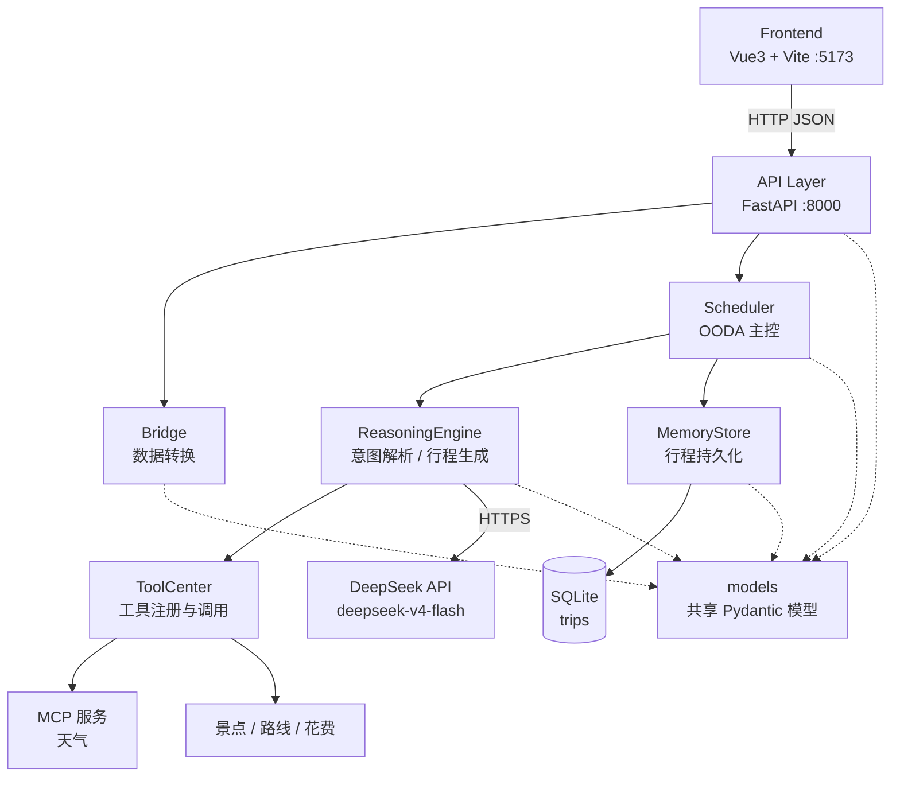

# 系统架构设计

> 项目：travel-agent2（旅行规划智能体 Web 应用）
> 依据：[docs/PRD.md](./PRD.md)
> 版本：v1.0
> 日期：2026-10-03

## 1. 架构总览

本项目采用 **前后端分离 + OODA 智能体架构**。

- **前后端分离**：前端（Vue3）只负责交互与渲染，通过 HTTP/JSON 与后端通信；后端（FastAPI）对外暴露 REST 接口，可脱离前端独立测试（对应 NFR-2）。
- **OODA 智能体架构**：后端业务逻辑按 OODA 决策循环组织为五个模块 —— 主控调度（Scheduler）、推理引擎（ReasoningEngine）、工具调用中心（ToolCenter）、记忆管理（MemoryStore）、前后端桥接（Bridge）。Scheduler 负责编排循环，其余四模块各自单一职责。

分层原则：`api/` 只做协议适配（校验、调用、异常转换），`src/` 承载全部业务逻辑，且不得依赖任何 Web 框架（对应 CLAUDE.md 目录约定）。

## 2. 模块划分（OODA 五模块）

### 2.1 主控调度模块（Scheduler）

- **职责**：接收用户输入 → OODA 循环决策 → 调度其他模块。不负责具体业务逻辑。
- **位置**：`src/scheduler.py`

| 方法 | 输入 | 输出 | 说明 |
| --- | --- | --- | --- |
| `process_input()` | `ChatRequest` | `AgentResult` | 单次对话入口 |
| `ooda_loop()` | `AgentContext` | `AgentContext` | Observe→Orient→Decide→Act 循环 |
| `route_action()` | `Action` + `AgentContext` | `AgentResult` | 按 action 分发到下游模块 |

### 2.2 推理引擎模块（ReasoningEngine）

- **职责**：解析用户意图 → 生成行程方案。
- **位置**：`src/reasoning.py`
- **依赖**：DeepSeek API（默认模型 `deepseek-v4-flash`）或 Mock 模式；ToolCenter（取天气 / 景点 / 路线 / 花费）。

| 方法 | 输入 | 输出 | 说明 |
| --- | --- | --- | --- |
| `parse_intent()` | `str` | `Intent` | 解析目的地 / 天数 / 预算 / 偏好 |
| `generate_itinerary()` | `Intent` | `TripPlan` | 生成结构化行程 |
| `refine_plan()` | `TripPlan` + `str` | `TripPlan` | 按追问修改已有行程 |

### 2.3 工具调用中心（ToolCenter）

- **职责**：管理所有外部工具 / MCP 的注册和调用。
- **位置**：`src/tools.py`
- **内置工具**：天气查询（经 MCP）、景点搜索、路线规划、花费计算。

| 方法 | 输入 | 输出 | 说明 |
| --- | --- | --- | --- |
| `register_tool()` | `ToolSpec` | `None` | 注册工具及其入参 schema |
| `call_tool()` | `str` + `BaseModel` | `BaseModel` | 按名调用，统一异常包装 |
| `list_tools()` | — | `list[ToolSpec]` | 供推理引擎感知可用能力 |

### 2.4 记忆管理模块（MemoryStore）

- **职责**：行程的持久化存取。
- **位置**：`src/memory.py`
- **存储**：SQLite，表名 `trips`。

| 方法 | 输入 | 输出 | 说明 |
| --- | --- | --- | --- |
| `save_trip()` | `TripPlan` | `TripRecord` | 落库并返回含 `trip_id` 的记录 |
| `list_trips()` | `int` (limit) | `list[TripRecord]` | 按时间倒序列出 |
| `search_trips()` | `str` (keyword) | `list[TripRecord]` | 关键词检索（FR-2） |
| `delete_trip()` | `str` (trip_id) | `bool` | 删除指定行程 |

### 2.5 前后端桥接模块（Bridge）

- **职责**：将内部数据结构转换为 API 响应 / 前端渲染格式。
- **位置**：`src/bridge.py`

| 方法 | 输入 | 输出 | 说明 |
| --- | --- | --- | --- |
| `parse_chat_request()` | `dict` | `ChatRequest` | 外部请求 → 内部模型 |
| `to_api_response()` | `BaseModel` \| `Exception` | `ApiResponse` | 内部结果 → 统一响应格式 |
| `to_trip_card()` | `TripPlan` | `TripCard` | 行程 → 前端卡片结构 |

> **共享模型层（`src/models/`）**：`TripPlan` / `TripRecord` / `ChatRequest` 等跨模块模型集中于此层，**不属于 OODA 五模块**。各业务模块单向依赖它，它不依赖任何业务模块 —— 以此避免同级模块之间的横向依赖。详见 [docs/sdd/models.md](./sdd/models.md)。

## 3. 模块依赖关系



> 实线为运行时调用，虚线为类型依赖。

**依赖方向（单向，禁止反向）**

| 调用方 | 被调用方 |
| --- | --- |
| Frontend | API Layer |
| API Layer | Bridge, Scheduler, models |
| Bridge | models |
| Scheduler | ReasoningEngine, MemoryStore, models |
| ReasoningEngine | ToolCenter, DeepSeek API, models |
| ToolCenter | MCP 服务、外部工具 |
| MemoryStore | SQLite, models |
| models | —（不依赖任何业务模块） |

> **说明**：`ReasoningEngine → DeepSeek API` 是推理引擎的直接依赖，不经由 ToolCenter —— ToolCenter 管理的是可注册的**业务工具**（天气 / 景点 / 路线 / 花费），LLM 推理通路不属于工具调用语义。

## 4. 数据流

### 4.1 正常流程：用户规划行程

1. 前端 POST `/api/chat`
2. API 层接收 → `Bridge.parse_chat_request()`
3. `Scheduler.ooda_loop()` → 识别 `action = "plan_trip"`
4. `ReasoningEngine.generate_itinerary()` → 经 `ToolCenter` 获取天气 / 景点
5. `MemoryStore.save_trip()` → 存入 SQLite
6. `Bridge.to_api_response()` → 返回统一格式 JSON
7. 前端渲染行程卡片

### 4.2 异常流程：DeepSeek API 不可用

1. 调用失败 → 捕获异常
2. 降级为模板方案
3. 返回响应标注 `data.degraded: true`

> 对应 PRD 的 AC-5：降级属预期内可用性设计，**不返回 5xx**，`code` 仍为 `0`，仅通过 `data.degraded` 区分。

## 5. 接口契约（概要）

详细 Schema 见 [docs/schemas/](./schemas/)。

统一响应格式：`ApiResponse` 模型（Pydantic v2）

| 端点 | 方法 | 对应 FR | 说明 |
| --- | --- | --- | --- |
| `/api/chat` | POST | FR-1, FR-4 | 对话入口，承载 plan / query / delete / chat 意图；可选 `start_date` 指定出发日期（v4.0） |
| `/api/trips` | GET | FR-2 | 历史行程列表（TripCard 数组） |
| `/api/trips/search` | GET | FR-2 | 按关键词检索 |
| `/api/trips/{trip_id}` | GET | FR-2 | 按 id 获取单条完整行程（TripRecord，含增强字段，v4.0 新增） |
| `/api/trips/{trip_id}` | DELETE | FR-2 | 删除指定行程，返回 `{trip_id, deleted}` |
| `/api/health` | GET | NFR-2 | 健康检查（含 LLM 通路状态） |

响应格式（对应 AC-3）：

```json
{ "code": 0, "msg": "ok", "data": { } }
```

错误：`{ "code": 非0, "msg": "错误描述", "data": null }`

## 6. 技术选型

| 层 | 选型 |
| --- | --- |
| 后端 | Python 3.11 + FastAPI + Pydantic v2 + SQLite |
| 前端 | Vue3 + Vite + Axios |
| AI | DeepSeek API（默认 `deepseek-v4-flash`，Mock 模式可关闭） |
| 测试 | pytest + pytest-cov |

> **已知约束**：SQLite 的写并发能力有限，NFR-1 的「并发 10 个用户」在读写混合场景下可能触发 `database is locked`。缓解手段（启用 WAL、写入串行化、连接池）需在记忆模块 SDD 中明确。
